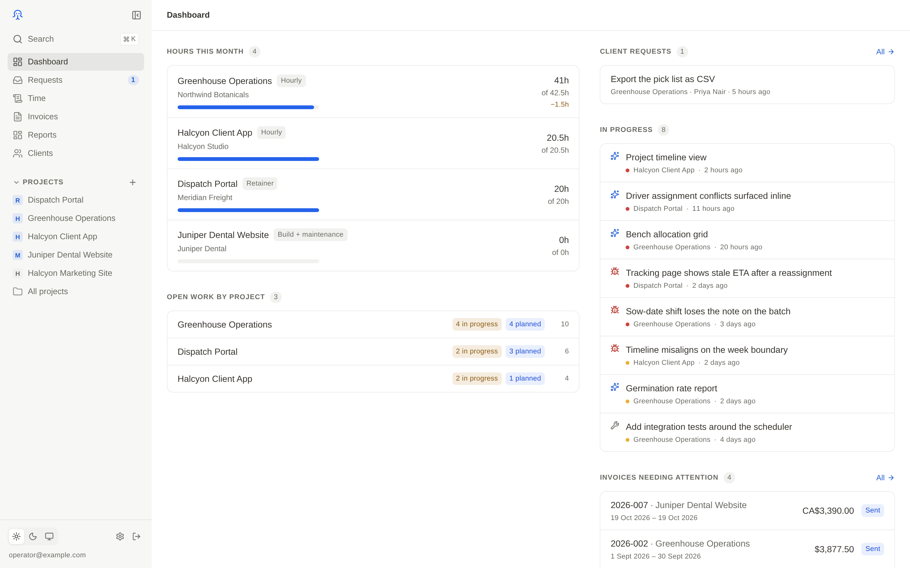
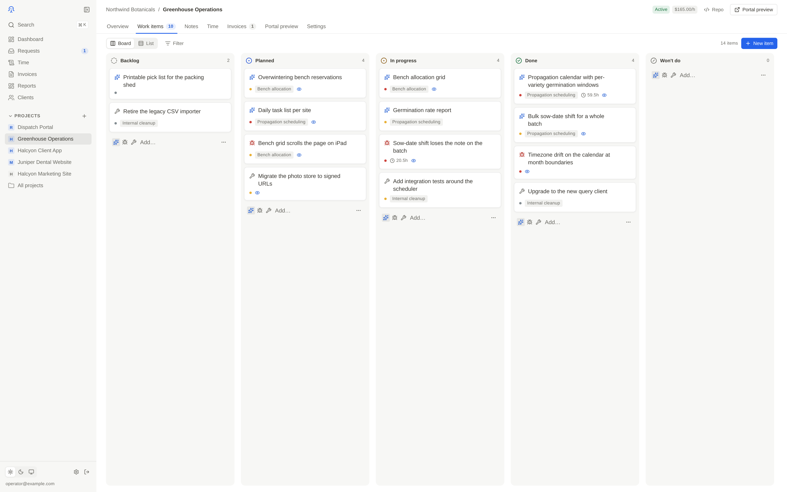
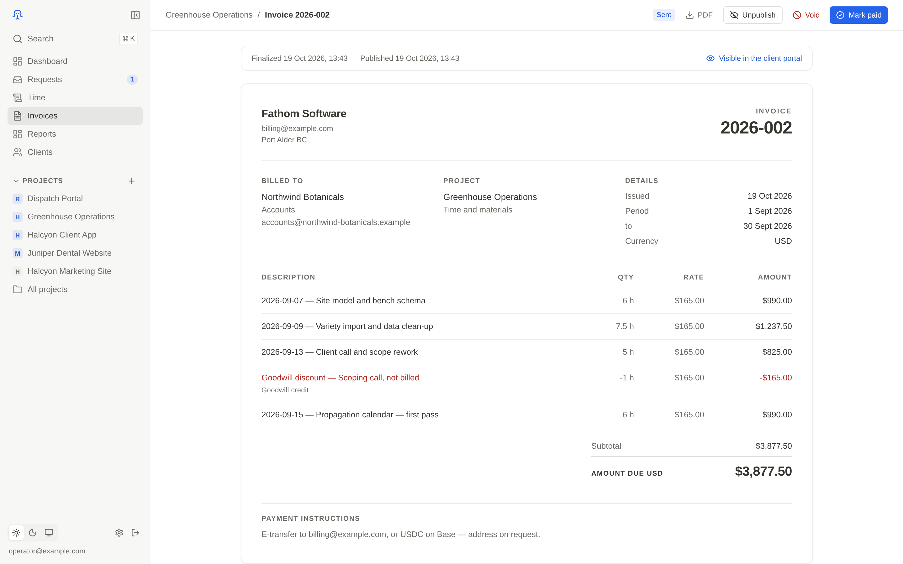
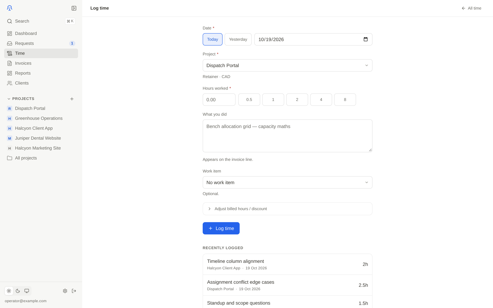
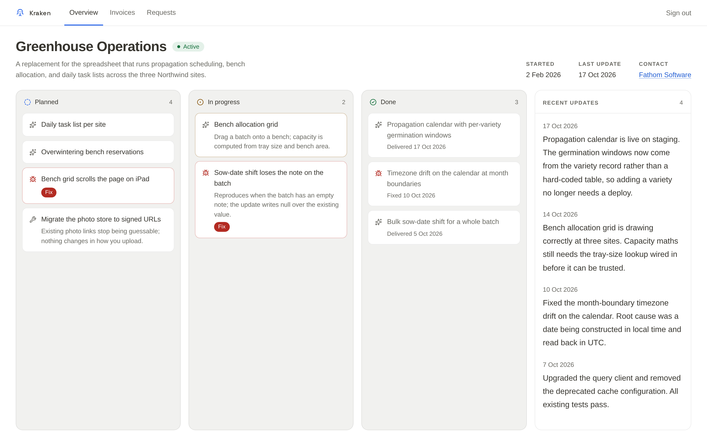
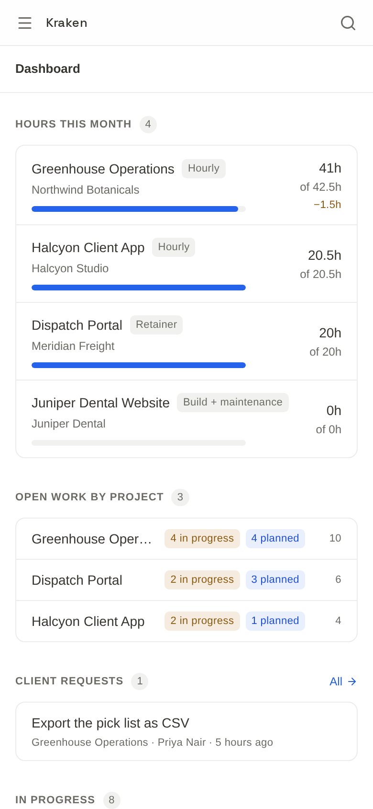

<p align="center">
  
</p>

<h1 align="center">Kraken</h1>

<p align="center">
  <b>Project management, time tracking and invoicing for solo developers, with a client portal.</b>
</p>

<p align="center">
  Deploy your own on Vercel and Supabase. Finalized invoices are immutable at the database level.
</p>

<p align="center">
  <a href="https://github.com/0xTropics/kraken-project-management/actions/workflows/ci.yml"></a>
  <a href="LICENSE"></a>
  
  
  <a href="CONTRIBUTING.md"></a>
</p>

<p align="center"><sub>Built with</sub></p>

<p align="center">
  
  
  
  
  
  
  
  
</p>

<p align="center">
  <a href="#features">Features</a> ·
  <a href="#getting-started">Quick start</a> ·
  <a href="#architecture">Architecture</a> ·
  <a href="#where-the-security-actually-lives">Security</a> ·
  <a href="#deployment">Deploy</a> ·
  <a href="#contributing">Contributing</a>
</p>

<picture>
  <source media="(prefers-color-scheme: dark)" srcset="docs/screenshots/dashboard-dark.png">
  
</picture>

## What it is

One operator, several clients, each paying differently. Kraken keeps the
whole loop in one place: log the hours, track the work, write the notes, turn
the unbilled time and costs into an invoice, and give the client a
password-protected view of their project's progress, invoices and requests.

It is built to the standard of software that handles other people's money.
Once an invoice is finalized, the database refuses any change to its amounts,
lines or number, whoever asks, the application included. The client portal's
isolation is a type-checked code boundary with an adversarial test suite
behind it.

## Features

- **Time.** Log hours against a project and, optionally, a work item. Billed
  hours can sit below worked hours as a goodwill discount, which the invoice
  shows as its own line. An entry locks to its invoice once that invoice is
  finalized.
- **Work items.** A board and a list over the same items: features, bugs and
  chores, grouped into milestones, each marked visible to the client or not.
- **Notes.** Private project notes in Markdown, and progress updates the
  client sees only once you approve them.
- **Invoices.** Drafts built from unbilled time and charges, then finalized,
  published to the portal, and marked paid, or voided and reissued. Three
  billing models: hourly, monthly retainer, and build plus maintenance, where
  build installments are capped by the build fee and maintenance terms are
  invoiced in advance. Deposits, one-off charges, per-project tax, USD and CAD,
  and a PDF of every invoice.
- **Reports.** Revenue by month as a chart and a table, and utilization per
  project, whose effective hourly rate shows when a retainer is running
  underwater. Money is reported per currency and never summed across
  currencies, and both reports export to CSV.
- **Client portal.** One URL and password per project. The client sees the
  work items you marked visible, approved updates, published invoices with
  their PDFs, and their own requests.
- **Client requests.** Clients submit feature requests from the portal, with
  up to three images each. From one inbox you accept each into a work item or
  decline it with a note, and the client sees its status move.
- **Everything else.** A command palette (<kbd>⌘K</kbd> or
  <kbd>Ctrl</kbd>+<kbd>K</kbd>) to jump to any project or page, an append-only
  audit log, light and dark themes, and every screen usable on a phone.

<table>
  <tr>
    <td width="50%"></td>
    <td width="50%"></td>
  </tr>
  <tr>
    <td width="50%"></td>
    <td width="50%"></td>
  </tr>
</table>

<p align="center">
  
</p>

## Stack

- **Next.js 16** (App Router) and **React 19**, in **TypeScript** with `strict`
  on.
- **Tailwind CSS v4**, with Radix primitives for dialogs, menus and tooltips.
- **PostgreSQL** through [`postgres`](https://github.com/porsager/postgres),
  with hand-written SQL and no ORM. The schema is plain SQL migrations, and
  its rules live in the database as constraints and triggers.
- **Supabase** for Postgres, Auth and Storage in production, on **Vercel**.
- `zod` at every API boundary, `jose` for signed cookies, argon2id for
  passwords, `@react-pdf/renderer` for invoice PDFs.
- **Vitest** against a real Postgres, **Playwright** for end-to-end tests, and
  axe-core for accessibility.

## Architecture

```
Next.js (Vercel)
  /app/**          internal UI     — internal session, allow-listed operator
  /portal/**       client UI       — signed cookie carrying one project id
  /api/internal/** internal routes — internal session
  /api/portal/**   portal routes   — portal cookie
        │
        ▼
Postgres (Supabase in production)  ·  Auth  ·  Storage
```

Two auth contexts that never substitute for one another:

| Context | Mechanism | Reaches |
|---|---|---|
| Internal | Supabase Auth session → uid on the `KRAKEN_INTERNAL_USER_IDS` allow-list | everything |
| Portal | signed cookie `{ project_id, password_version }` | read-only portal data for that one project, plus submitting its own requests |

Their separation is enforced by distinct JWT audiences, distinct code paths, and
tests in `test/security/auth-boundaries.test.ts` that try to use each credential
in the other's place.

The internal row describes production. `KRAKEN_AUTH_MODE=local` swaps that one
mechanism for an argon2id password in `internal_users` and a self-signed cookie,
so the tests and the dev server run without a cloud project. It is a
development harness, not a way to deploy Kraken. The portal context is
identical in both.

### Where the security actually lives

- **Row Level Security is on for every table, with no policies at all**, so a
  leaked anon key reads nothing. No browser ever holds a key with table access:
  every query runs on the server, connected as the table owner, which RLS does
  not apply to because it is enabled but not forced. There is no per-user
  database identity to write a policy against in any case.
- **The portal's isolation is a code boundary**, in `src/lib/data/portal.ts`.
  Every query there filters by `scope.projectId`. `PortalScope` is a branded
  type whose producers verify a signed cookie against the live project row.
  The one exception is the operator's own portal preview inside the internal
  app, which no portal route can reach. No portal route accepts a project id
  from a request.
- **Portal sign-in locks out after 10 failures in 15 minutes** from one IP
  against one portal. Once locked, even the right password is refused with a
  429, and the refused attempts count as failures too. An unknown portal
  address locks exactly like a real one, so the lockout cannot be used to
  discover which portals exist. The IP comes from `x-forwarded-for`, which
  Vercel overwrites with the real client address; on any other host, that
  header has to be set by a proxy you trust.
- **Portal sessions are stateless signed cookies.** Signing out clears the
  browser's copy; it does not revoke a copy someone else already holds.
  Rotating the project's portal password is what invalidates outstanding
  cookies, immediately and for everyone. Both behaviours are asserted in
  `test/integration/portal-login.test.ts`, so the guarantee is the one
  documented rather than the one assumed.
- **Client requests are untrusted input.** The upload route rejects a foreign
  `Origin`, checks each image's actual file signature rather than its claimed
  type, and caps a project at 10 requests in a rolling 24 hours, re-checked
  under a row lock so two simultaneous submissions cannot both take the last
  slot.
- **Finalized invoices are immutable**, enforced by triggers on `invoices`,
  `invoice_lines` and `time_entries`. Corrections are void-and-reissue: voiding
  releases the time entries the invoice locked, and its number is never reused.
- **The audit log rejects UPDATE and DELETE**, even from the owning role the
  server connects as: row triggers refuse both, so it does not rest on grants
  alone.

### Keeping the money right

- Money arithmetic is integer cents, never floating point.
- A deposit is applied after tax, never as a negative line that would shrink
  the taxable base. The deposit balance is derived, not stored, so voiding an
  invoice hands its deposit back with no bookkeeping.
- Whether a charge has been billed is derived from the invoice lines that point
  at it, so voiding an invoice or deleting a draft returns its charges to
  unbilled.
- Maintenance coverage is the set of periods already invoiced, not a single
  "covered through" date, so voiding one term in the middle leaves a gap the
  next run fills.
- The billed-to details are a snapshot frozen at finalization. Editing a
  client's contact later does not rewrite an invoice they already received.

## Getting started

You need:

- **Node 22.13 or later, up to 24.x.** `.nvmrc` pins 24; `nvm install` reads
  it, installs that version if needed, and switches to it. That switch lasts
  for one terminal: in a new one, run `nvm use` in the repo (or set the default
  once with `nvm alias default 24`).
- **PostgreSQL 15 or later**, the binaries only. No Docker, no system service,
  no cloud account: `npm run db:start` creates a cluster inside the repo.
- **macOS, Linux or WSL.** The database script is POSIX-only.

```bash
# macOS
brew install postgresql@17
# Debian/Ubuntu. Older releases ship a version below 15; if yours does, add the
# PostgreSQL apt repository (apt.postgresql.org) and install postgresql-17.
sudo apt install postgresql
```

Then:

```bash
git clone https://github.com/0xTropics/kraken-project-management.git
cd kraken-project-management
nvm install
npm ci
npx playwright install chromium   # for test:e2e and the check:* scripts; add --with-deps on Linux
cp .env.example .env.local
openssl rand -base64 48   # paste the output into KRAKEN_SESSION_SECRET in .env.local

npm run db:start          # a Postgres cluster in .pgdata/, on port 54329
npm run db:migrate
npm run db:seed           # demo data; prints every sign-in it creates
npm run dev               # http://localhost:3100
```

The seed creates these sign-ins. They exist **only in local development**: a
deployed Kraken authenticates the operator through Supabase Auth, and each
project's portal password is set when the project is created.

| Surface | Where | Credentials |
|---|---|---|
| Internal app | `/app` | `operator@example.com` / `Password` |
| Client portal | `/portal/greenhouse-ops` | `seagrass-lantern-42` |

The local cluster is a real PostgreSQL server running the same migrations
production runs, reached through the same driver. Nothing about the database is
simulated.

```bash
npm run db:psql           # psql against the local cluster
npm run db:stop
npm run db:reset          # delete the cluster, recreate it, migrate, seed
```

To run the tests, keep the cluster running: `npm test` and `npm run verify`
need `npm run db:start` first. The end-to-end suite and the `check:*` scripts
also drive a browser, which is what the `npx playwright install chromium` line
above installs.

## Configuration

Everything is in [`.env.example`](.env.example), which is the authoritative
list. Two switches decide how much of Supabase is in play:

| Variable | `local` (default) | `supabase` |
|---|---|---|
| `KRAKEN_AUTH_MODE` | Kraken verifies an argon2id password against `internal_users` and signs its own session cookie | Supabase Auth issues the session; `KRAKEN_INTERNAL_USER_IDS` is the allow-list of user ids permitted into `/app` |
| `KRAKEN_STORAGE_MODE` | files on disk under `.storage/`, served through a short-lived HMAC-signed URL | files in a private Supabase Storage bucket, served through a short-lived signed URL |

A deployment uses `supabase` for both. The database layer, the API, the
invoicing engine and the portal are identical in either mode; only identity and
file storage move.

`SUPABASE_SERVICE_ROLE_KEY` is a server-only secret. It belongs in the Vercel
environment and nowhere else: never in a `NEXT_PUBLIC_` variable, never on a
laptop.

## Tests

```bash
npm test                       # 481 unit, integration and security tests
npx vitest run test/security   # the adversarial suite only (73)
npm run test:e2e               # 30 Playwright tests: 15 scenarios, at desktop and phone width
npm run verify                 # typecheck, lint, tests, a production build, and an optional private-terms
                               # check (active only if a git-ignored .private-terms file exists)
```

Every Vitest run creates its own database on the local cluster and applies the
real migrations to it, so the tests exercise the same constraints and triggers
production has. The end-to-end suite needs seeded data, and starts the dev
server itself if one is not already running.

`test/security/` is the part that matters. It tries to do the things Kraken
forbids, against a real Postgres with the real schema:

- edit, delete, re-number or un-finalize an invoice, or touch its lines
- edit or delete a time entry locked to one
- update or delete an audit row
- see an unapproved note, a hidden work item, an unpublished invoice, or any
  money figure in the portal
- submit a request into another project, from a foreign origin, with a
  non-image, or past the daily limit
- use a portal cookie for another project, after a password rotation, with a
  forged signature, or in place of an internal session
- keep guessing a portal password past the lockout
- reach an internal page without a valid session

The security logic runs for real against a real Postgres; the only stub is the
request's cookie jar in one test. None of these attempts is allowed to pass.

Three more checks catch what unit tests cannot. They need the dev server
running (`npm run dev`) against seeded data:

```bash
npm run shots              # every surface at 1440px and 390px, light and dark,
                           #   into docs/evidence/current; fails on console errors
npm run check:responsive   # every surface at 390, 768 and 1440px; fails if
                           #   anything escapes the viewport
npm run check:a11y         # axe-core, WCAG 2.1 AA; fails on serious or critical
```

## Deployment

Kraken deploys to Vercel, with Supabase for Postgres, Auth and Storage.
Connect through Supabase's **session pooler**, not the transaction pooler:
postgres.js pipelines a page's concurrent queries, and transaction mode
misroutes their results. [`docs/DEPLOYMENT.md`](docs/DEPLOYMENT.md) walks
through every step, from creating the project to the first deploy.

## Project layout

```
src/app/              routes: /app (internal), /portal, /login, and the API
src/components/       UI, one folder per area; shared primitives in ui/
src/lib/
  data/               queries, one module per domain;
                      portal.ts is the portal's isolation boundary
  invoices/           the invoicing engine: lines, totals, maintenance terms
  auth/               the two session types and password hashing
  db/  storage/  pdf/ the Postgres pool, file storage, invoice PDFs
supabase/migrations/  the schema, append-only and checksummed
test/
  unit/               pure logic
  integration/        data and route behaviour against real Postgres
  security/           the adversarial suite
  e2e/                Playwright
scripts/              local cluster, migration runner, seed, screenshot and audit tools
docs/                 deployment guide and screenshots
```

## Contributing

Issues and pull requests are welcome. See [CONTRIBUTING.md](./CONTRIBUTING.md)
for conventions and the definition of done. Kraken is maintained by one person,
so please open an issue before starting anything large.

## Security

Please report vulnerabilities privately, as described in
[SECURITY.md](./SECURITY.md), and not in a public issue.

## License

[MIT](./LICENSE)
